# Practice #12: Code-based vs low-code, Smart Campus Room Availability Checker

| | |
|---|---|
| Course | AI-Driven Software Engineering, Practice #12 (Lesson 12) |
| Student | Alan Zhumadilov, ID: 24B031793 |
| Class time | Wed, 15-00 |
| AI tool | Claude by Anthropic, model Claude Opus 5.5 (`claude-opus-5-5`)|
| Code-based live demo | https://adilan4ever1.github.io/smart-campus-practice12/ |
| Low-code live app (Power Apps) | https://apps.powerapps.com/play/e/default-57081b5e-e66a-4993-8eaf-15b0b309293f/a/b99d312e-0402-4e18-97f3-4d812cc79ac1?tenantId=57081b5e-e66a-4993-8eaf-15b0b309293f |
| Repository | https://github.com/Adilan4ever1/smart-campus-practice12 |
| Date | 25 November 2026 |

All data in both apps is fictional. There is no login, no payment and no production database.

---

## Task 01: Freeze the baseline

No code-based checker from earlier practices was available, so a clean HTML/JavaScript version was written first and frozen as the baseline before the low-code work started.

- Baseline version: `v1.0.0` (shown in the page header)
- Booking data: three fictional bookings for Room B-204 on 2027-02-01 (see the contract below)
- Expected behaviour: the six acceptance criteria and eight test cases in [docs/CONTRACT.md](docs/CONTRACT.md)
- Existing checks: `node tests/run-tests.js` returned 8/8 plus 6/6 extra unit checks (exit code 0)
- The booking rules were not changed afterwards to favour either approach. The Power Apps version reuses exactly the same bookings, rule order and test inputs.

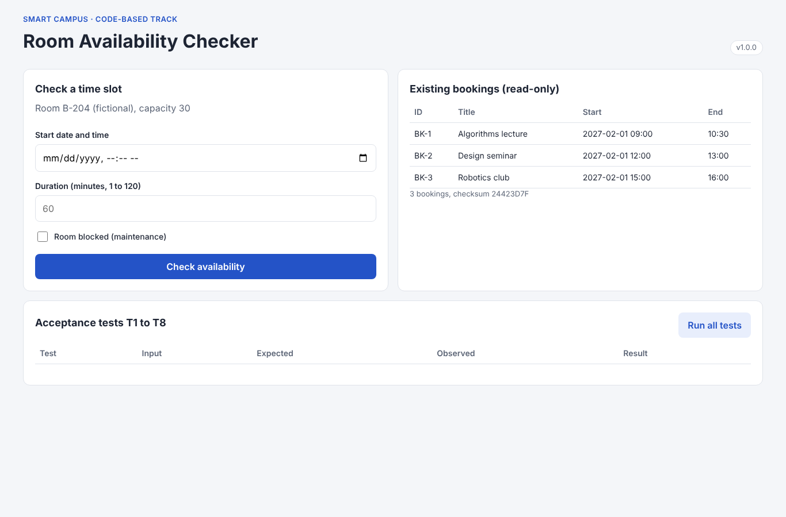
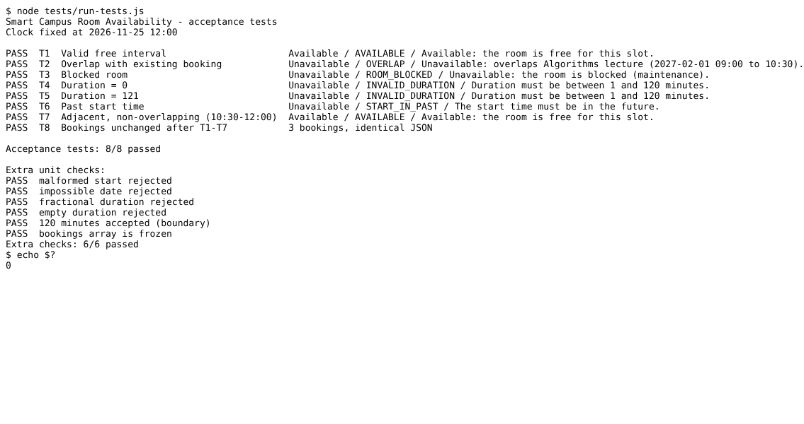

## Task 02: Shared contract (requirements and acceptance-criteria sheet)

The full sheet is in [docs/CONTRACT.md](docs/CONTRACT.md). Summary:

**User story.** As a student, I want to pick a future start time and a duration for Room B-204, so that I can see straight away whether the room is available and, if it is not, why.

| ID | Acceptance criterion |
|----|----------------------|
| AC1 | The start time must be in the future. |
| AC2 | Duration must be greater than zero and at most 120 minutes. |
| AC3 | A request that overlaps an existing booking is unavailable. |
| AC4 | A blocked room is unavailable. |
| AC5 | The app shows a clear decision and never changes the existing bookings. |
| AC6 | Invalid input receives understandable feedback. |

**Inputs:** start time (date + time, minute precision), duration (whole minutes), blocked flag (boolean), fixed fictional bookings.

**Outputs:** `available` (boolean), `reasonCode` (`AVAILABLE`, `OVERLAP`, `ROOM_BLOCKED`, `START_IN_PAST`, `INVALID_DURATION`, `INVALID_INPUT`) and a visible message.

**Rule order:** missing start, then past start, then duration, then blocked flag, then overlap. Intervals are half-open `[start, end)`, so touching edges do not overlap.

| ID | Title | Start | End |
|----|-------|-------|-----|
| BK-1 | Algorithms lecture | 2027-02-01 09:00 | 10:30 |
| BK-2 | Design seminar | 2027-02-01 12:00 | 13:00 |
| BK-3 | Robotics club | 2027-02-01 15:00 | 16:00 |

## Task 03: Code-based solution

Stack: plain HTML, CSS and JavaScript with no third-party dependencies. Node.js is used only to run tests.

| Layer | File | Responsibility |
|-------|------|----------------|
| Data | `src/data.js` | Fictional room and bookings, deep-frozen with `Object.freeze` |
| Rules | `src/rules.js` | `validate()`, `overlaps()`, `checkAvailability()`. Pure functions with no DOM access, and the clock is passed in as `now` |
| Presentation | `src/app.js`, `index.html`, `src/styles.css` | Reads the form, calls the rules, renders output with `textContent` only |
| Tests | `tests/cases.js`, `tests/run-tests.js` | The same T1 to T8 inputs are used by the Node runner and by the in-page "Run all tests" button |

The layout is a two-column grid on desktop and switches to one column below 760 px.

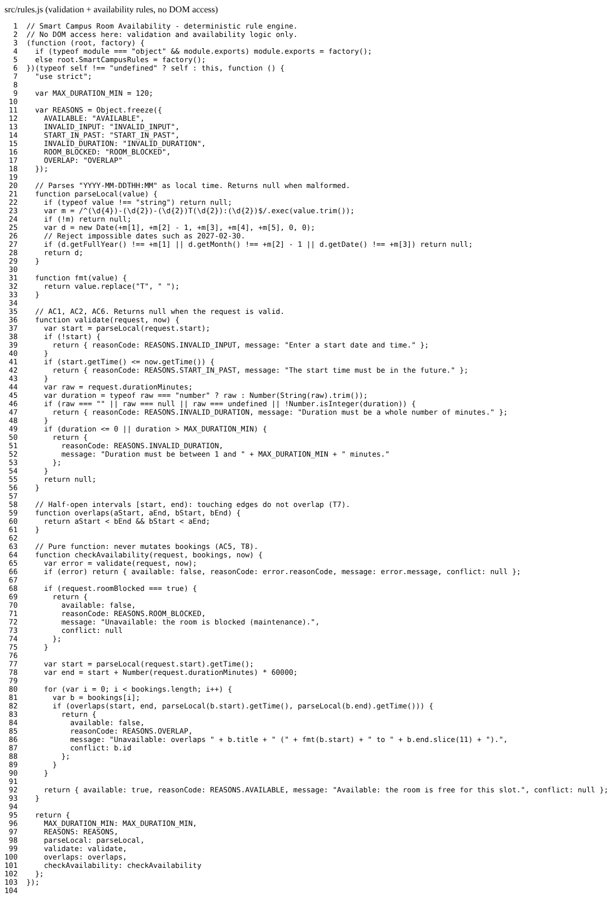
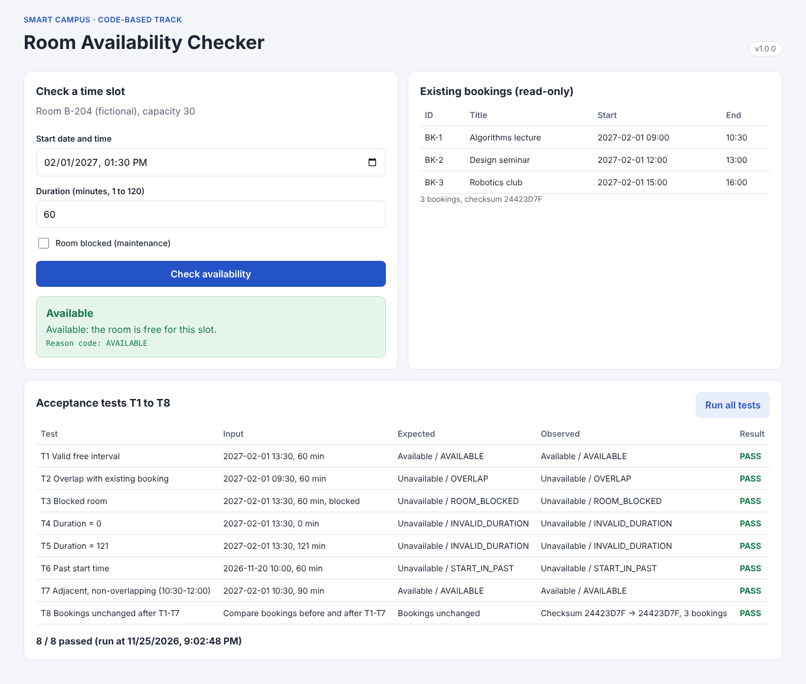

Live demo on GitHub Pages, opened in Chrome:

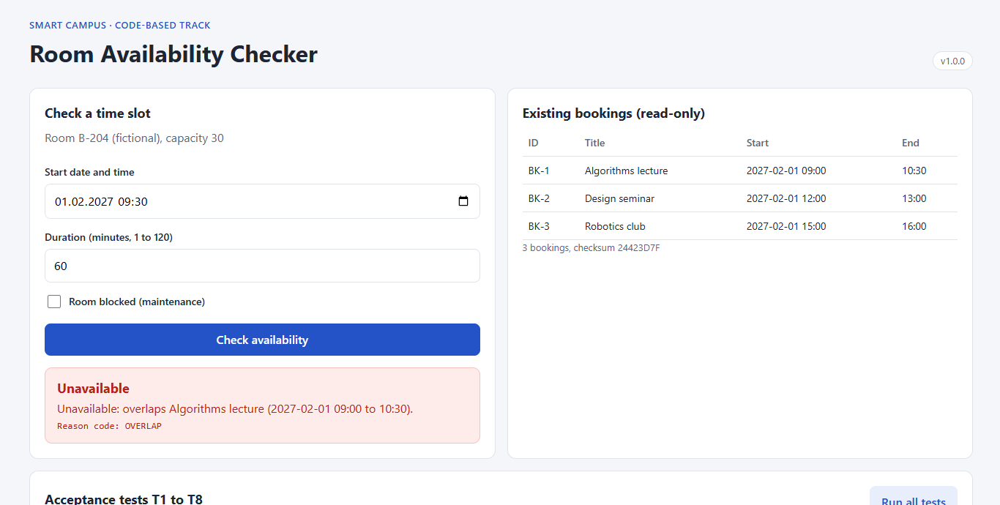
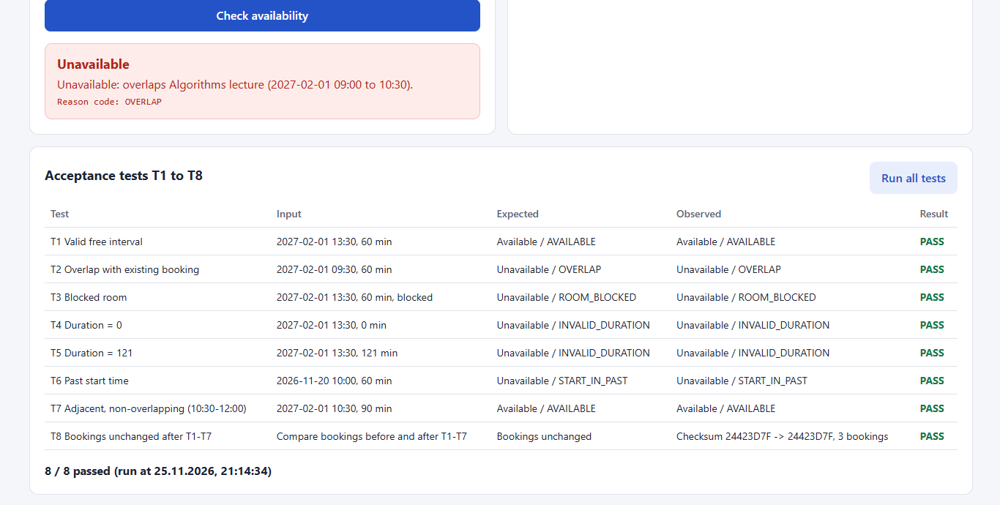
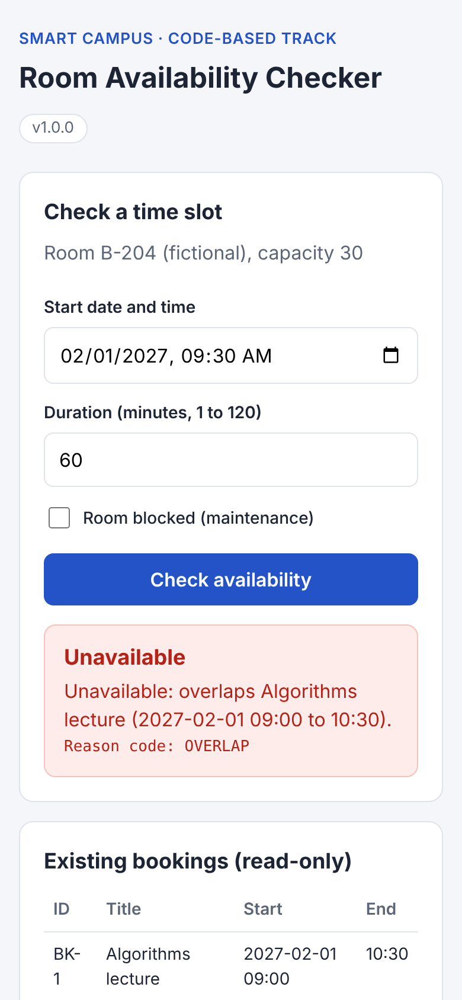

## Task 04: Low-code solution (Microsoft Power Apps, canvas app)

Environment: make.powerapps.com, KBTU tenant, default environment, tablet canvas app `SmartCampusRoomChecker`. No subscription was bought. The app has no data sources and no connectors.

How it was built:

1. Created a blank tablet canvas app.
2. Put the booking data and rules in **App > Formulas**:
   - `Bookings` is a named formula (an immutable table), so nothing in the app can write to it.
   - `DurationValid()`, `FirstConflict()`, `ReasonCode()` and `ResultMessage()` are Power Fx user-defined functions. These are the platform expressions that hold the rules, kept apart from the screen.
3. Added the screen controls (classic Date picker, two Drop downs for hour and minute, Text input for duration, Toggle for the blocked flag, Buttons, Labels and two Galleries) by pasting Power Apps YAML into the tree view. The source is kept in [`lowcode/screen-controls.pa.yaml`](lowcode/screen-controls.pa.yaml) and [`lowcode/App.Formulas.fx`](lowcode/App.Formulas.fx).
4. "Run all tests" calls the same `ReasonCode()` function with the T1 to T7 inputs and compares JSON snapshots of `Bookings` for T8.
5. Saved and published the app (version published 25.11.2026 21:00).

Requirements the platform could not meet the same way (labelled as limitations, not hidden):

- **Narrow screens:** the canvas is a fixed 1366 x 768 layout that Power Apps scales down. On a phone it shrinks and letterboxes instead of reflowing the way the code-based page does. A responsive version would need containers and `Parent.Width` formulas for every control.
- **Time input:** minutes are picked in 5-minute steps from a drop-down. Every contract test uses a multiple of 5, so no test is affected.
- **T8 is partly guaranteed by the platform:** `Bookings` is a named formula, so the app cannot modify it at all. The test still compares before and after snapshots, but it cannot fail by design.
- **Locale:** the studio runs in Russian, so the formula bar shows `;` as the separator. The YAML source in the repo uses the invariant `,` form.
- No behaviour was simulated. All eight results come from the running app.

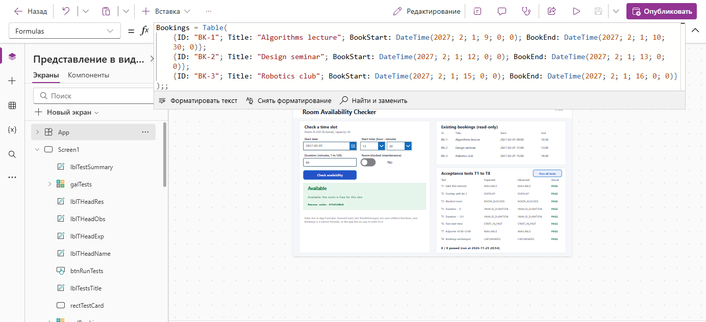
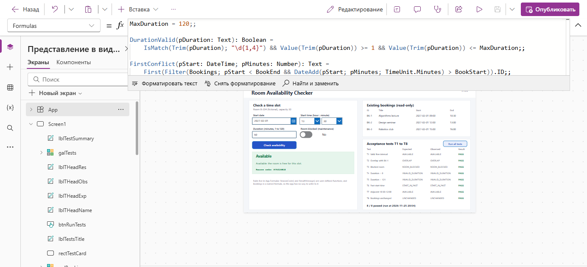
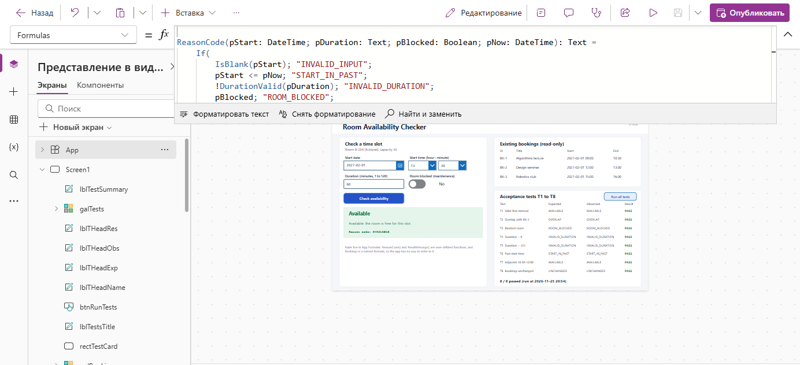
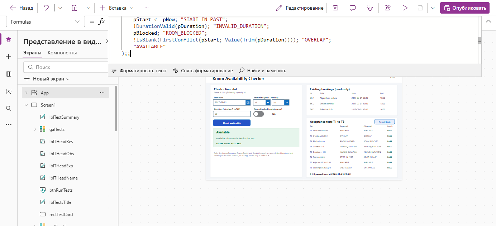
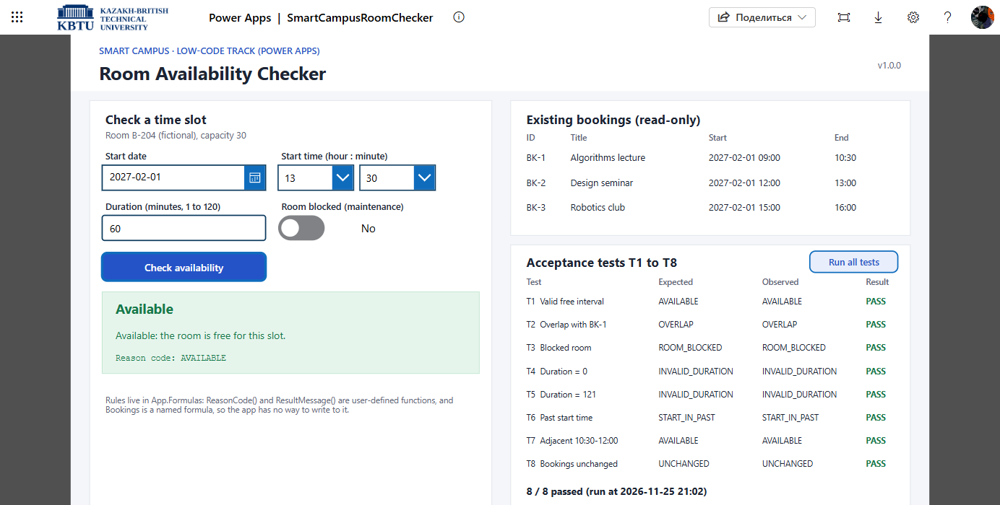

## Task 05: Identical tests (eight-case table)

The same inputs were entered by hand through the UI of both apps, and the built-in "Run all tests" panel was run as well. Test date: 25 Nov 2026 (the clock was "now" for T6, and the Node runner fixes it at 2026-11-25 12:00).

| Test | Input | Expected | Code-based observed | Low-code observed |
|------|-------|----------|---------------------|-------------------|
| T1 valid free interval | 2027-02-01 13:30, 60 min | Available / AVAILABLE | Available / AVAILABLE, PASS | Available / AVAILABLE, PASS |
| T2 overlap | 2027-02-01 09:30, 60 min | Unavailable / OVERLAP | Unavailable, overlaps Algorithms lecture, PASS | Unavailable, overlaps Algorithms lecture, PASS |
| T3 blocked room | 13:30, 60 min, blocked | Unavailable / ROOM_BLOCKED | ROOM_BLOCKED, PASS | ROOM_BLOCKED, PASS |
| T4 duration 0 | 13:30, 0 min | Validation error / INVALID_DURATION | "Duration must be between 1 and 120 minutes.", PASS | "Duration must be a whole number between 1 and 120 minutes.", PASS |
| T5 duration 121 | 13:30, 121 min | Validation error / INVALID_DURATION | Same message as T4, PASS | Same message as T4, PASS |
| T6 past start | 2026-11-20 10:00, 60 min | Validation error / START_IN_PAST | "The start time must be in the future.", PASS | Same text, PASS |
| T7 adjacent interval | 2027-02-01 10:30, 90 min (ends 12:00) | Available / AVAILABLE | AVAILABLE, PASS | AVAILABLE, PASS |
| T8 bookings unchanged | Compare before and after T1 to T7 | 3 bookings, identical | Checksum 24423D7F before and after, PASS | JSON snapshot equal, 3 rows, PASS |
| **Total** | | | **8 / 8** | **8 / 8** |

Per-test screenshots:

| Test | Code-based | Low-code |
|------|------------|----------|
| T1 |  | 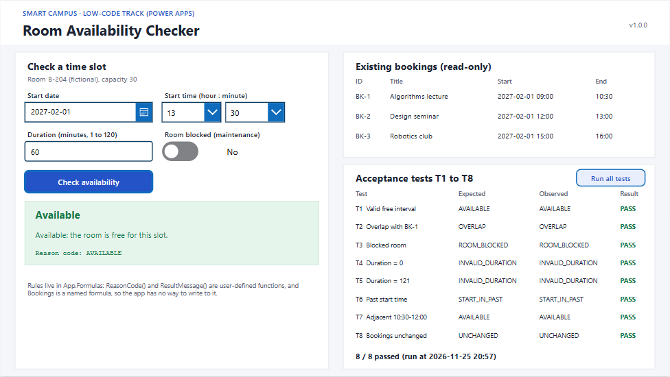 |
| T2 | 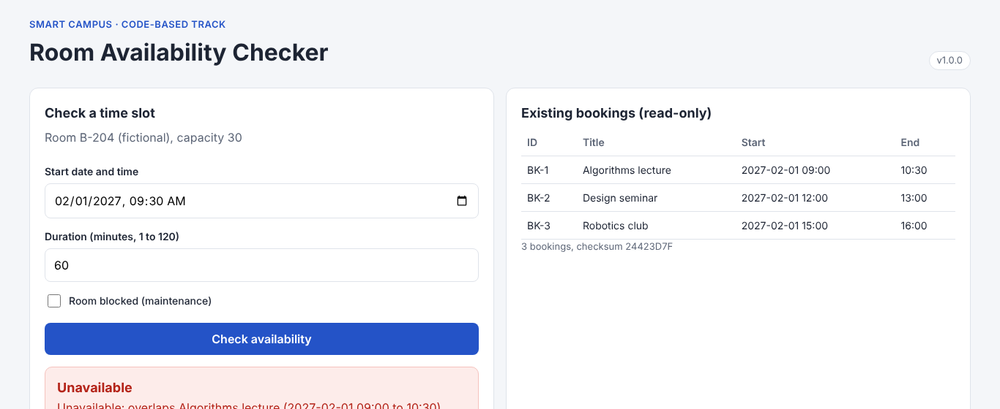 | 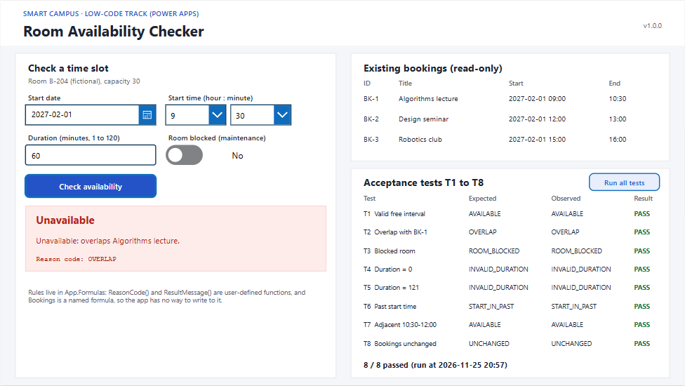 |
| T3 | 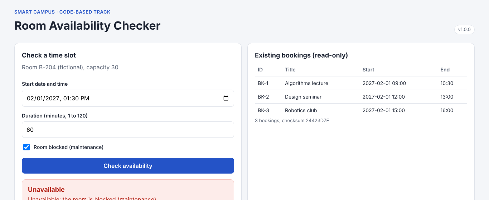 | 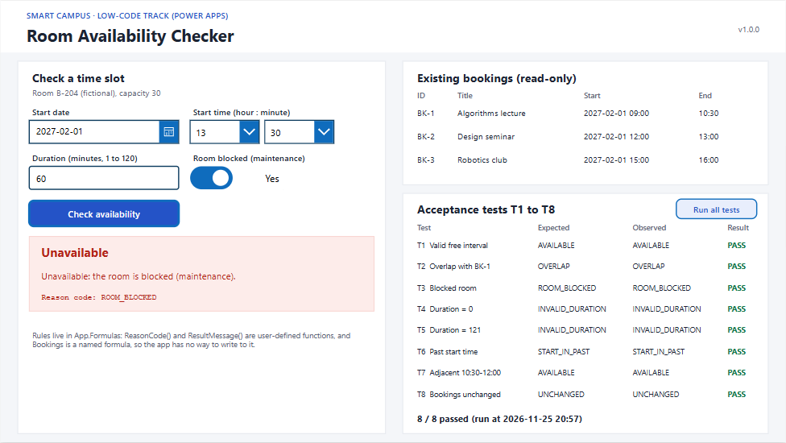 |
| T4 |  | 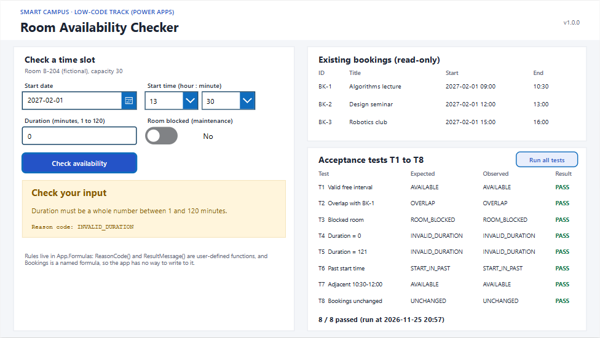 |
| T5 | 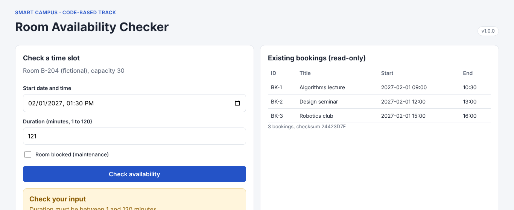 |  |
| T6 |  |  |
| T7 | 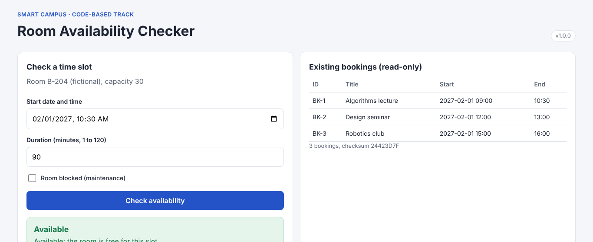 |  |
| T8 |  |  |

## Task 06: Engineering effort

Times are wall-clock minutes taken from timestamps recorded during the session (UTC 14:42 to 15:02). Both versions were produced by the same AI agent, so these numbers measure agent time, not how long a student would need by hand. That makes the *difference* between them meaningful, but not the absolute values.

| Phase | Code-based | Low-code (Power Apps) |
|-------|-----------:|----------------------:|
| Setup | 0.5 min (folders) | 2 min (create app, studio load, dialogs) |
| Implementation | 1 min | 7 min (includes learning the YAML paste format) |
| Debugging | 0 min | 3 min |
| Testing | 0.5 min | 4 min (UI is driven through dropdowns and clicks) |
| **Build and repair total** | **about 2 min** | **about 16 min** |
| Publishing (not counted above) | about 5 min (create repo, upload through the browser, enable Pages) | about 1 min (Publish button) |
| Acceptance tests passed | 8 / 8 | 8 / 8 |
| Defects found during build | 0 | 2, both fixed |
| Unresolved defects | 0 | 0 |

Low-code defects found and fixed:

1. The first YAML paste was rejected with `PA1001 YamlInvalidSyntax` because a label text contained `": "`. Fixed by switching those values to block scalars.
2. The toggle showed Russian default labels ("Отключен"/"Включен"). Fixed by setting `FalseText = "No"` and `TrueText = "Yes"`. T3 was then re-run and re-captured.

**Review, export and version control**

| | Code-based | Low-code |
|---|---|---|
| Change review | Git diffs and pull requests on GitHub, line by line | Power Apps keeps a version list (Versions tab) with restore, but no line-level diff or review inside the studio |
| Export | The repository *is* the export, and it runs in any browser | Code view / YAML copy for screens, an `.msapp` file or a solution package. Runs only on the Power Apps runtime |
| Version control | Full Git history | The YAML and formulas were copied into this repo by hand. Proper Git integration needs solutions and extra setup that was not done here |

**Measured vs impression.** Measured: the times, the pass counts, the two defects. Impressions (not measured): the Power Apps studio felt heavier to iterate in because every manual test needs several clicks, and the platform's built-in validation, rendering and hosting removed whole categories of work that the code-based version handles itself.

## Task 07: Security review (Lecture #12)

| Check | Code-based | Low-code (Power Apps) |
|-------|------------|-----------------------|
| Input validation (injection) | Strict regex parse of `YYYY-MM-DDTHH:MM`, impossible dates rejected, duration must be an integer from 1 to 120 | `IsMatch(..., "\d{1,4}")` plus a range check. The duration box has `MaxLength = 6` |
| Output handling (XSS) | Output is written with `textContent` only. A static grep found no `innerHTML`, `document.write`, `eval` or `new Function`. A CSP meta tag allows scripts from `'self'` only | Labels render plain text, and Power Fx has no HTML sink in this app (no HTML text control used) |
| Runtime probe (DAST, safe, own app only) | `` typed into duration (field type switched to text in DevTools): rejected as INVALID_DURATION, nothing executed ([screenshot](docs/screenshots/code-10-security-markup-probe-rejected.png)) | `` typed into duration: rejected as INVALID_DURATION, shown as plain text ([screenshot](docs/screenshots/lowcode-11-security-markup-probe-rejected.png)) |
| Permissions / sharing | Public static site and public repo, by design. Nothing private in it | App published in the KBTU tenant. Not shared with anyone except the owner. Viewers would need to be added via Share |
| Secrets | None. No API keys, tokens or passwords in the source (grep checked) | None. No connectors, no data sources, no environment variables |
| Connector access | None | None (Data panel empty) |
| Dependencies (SCA) | Zero third-party packages (no `package.json`). The only runtime is the browser | Microsoft patches the platform and controls. Control versions are pinned in the YAML (`Label@2.5.1`, `Classic/Button@2.2.0`, ...). The owner has to re-open and republish to pick up control updates |
| Data exposure | Fictional data only | Fictional data only. The play link reveals the tenant ID, which is an identifier, not a secret |
| Low-code is not automatically secure | n/a | Agreed. Security here comes from not adding connectors, not sharing, and validating input, not from being low-code |
| Third-party scanning | Not done (not authorised) | Not done (not authorised) |

**AI-agent least privilege note.** The agent worked inside the student's own signed-in Chrome and Power Apps session. It only opened the student's own app, did not touch other apps in the environment, and overwrote the clipboard several times to paste code. For a real project, a separate low-privilege maker account or a sandbox environment would be safer.

## Comparison matrix

| Criterion | Code-based | Low-code (Power Apps) |
|-----------|------------|-----------------------|
| Functional tests | **8 / 8** | **8 / 8** |
| Build and repair time | **about 2 min** (agent) | **about 16 min** (agent) |
| Customization | Full control of layout, responsive design, messages and rules | Good for forms and galleries. The fixed canvas is not responsive by default, and time input was limited to 5-minute steps |
| Security controls | Explicit: CSP, safe DOM sinks, strict parsing, frozen data. Fully reviewable in code | Platform handles rendering and authentication. The owner controls sharing, connectors and DLP. Less visible to code review |
| Versioning / portability | Git history, PR review, runs anywhere a browser runs, trivially portable | Version list in Power Apps. YAML copy is possible, but the app only runs on the Power Apps runtime, so vendor lock-in |
| Ongoing cost | $0 (GitHub Pages for a public repo) | $0 here under the university Microsoft 365 tenant (licence shown as "Standard"). Use outside the tenant or premium connectors would need paid Power Apps licences |

### Recommendation

For this feature, the **code-based version is the better choice**. The rules are small and deterministic, so they gain more from unit tests, Git review and a responsive layout than from a visual builder. It also took less time to build and repair, costs nothing to host, and has no vendor lock-in. Power Apps would make sense if the checker had to live inside the university's Microsoft 365 environment, read rooms from SharePoint or Dataverse, and be maintained by staff who do not write code. In that case the rules in `App.Formulas` already show it can be done without losing correctness.

## AI-use reflection

- **Tool:** Claude by Anthropic, model Claude Opus 5.5 (`claude-opus-5-5`), working as an agent with browser control of the student's Chrome.
- **What the AI did:** wrote the shared contract, the code-based app and its tests, generated the Power Apps formulas and YAML, built and published the Power Apps app, ran both test suites, captured the screenshots, and drafted this report.
- **How the output was checked:** every pass in the tables comes from a test that was actually run (the Node runner exit code, the in-app test panels, and manual UI entry), with screenshots of each case. No result was written down before it was observed.
- **Where the AI got it wrong at first:** the first Power Apps paste failed on YAML syntax, and the toggle kept its Russian default labels. Both were caught by looking at the running app, not by trusting the generated code.
- **Takeaway:** the AI is fast at producing both versions, so the engineering value is in the contract and the tests. Writing the eight cases before either implementation is what made the comparison fair.

## Repository contents

```
index.html                  code-based app (GitHub Pages entry)
src/                        data.js, rules.js, app.js, styles.css
tests/                      cases.js (T1-T8), run-tests.js (node)
lowcode/                    Power Apps source: App.Formulas.fx, screen-controls.pa.yaml
docs/CONTRACT.md            shared requirements and acceptance-criteria sheet
docs/Practice12_Report_Alan_Zhumadilov.pdf   this report as PDF
docs/screenshots/           all evidence screenshots
REPORT.md                   this report
```
